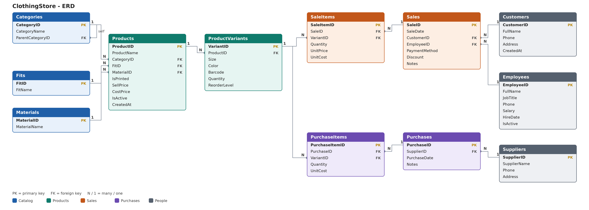

<div dir="rtl">

# قاعدة بيانات محل ملابس

قاعدة بيانات على SQL Server لمحل ملابس حقيقي. بتتابع المنتجات والمخزون والمبيعات والمشتريات والأرباح. المنتجات والأقسام اتكتبت من دفتر المحل نفسه.



## اللي في المشروع

- 12 جدول.
- 3 تريجرات بتحدث المخزون لوحدها: البيع بينقص الكمية، والشراء بيزودها.
- 3 فيوز جاهزة للتقارير.
- 4 اجراءات لتسجيل البيع والشراء بالباركود.
- 26 منتج في 3 أقسام رئيسية: هوديز وسويتشيرتات، بناطيل، كلاسيك.
- 315 مقاس ولون، كل واحد له كمية وباركود.

## الجداول

| الجدول | وظيفته |
|---|---|
| `Categories` | الأقسام الرئيسية والفرعية |
| `Fits` | القصات زي اوفر سايز وبوكس فيت ووايد ليج |
| `Materials` | الخامات زي ميلتون استرتش وقطن وجينز |
| `Products` | المنتجات وسعر الجملة وسعر البيع |
| `ProductVariants` | المقاسات والالوان والكميات والباركود |
| `Customers` | العملاء |
| `Employees` | الموظفين |
| `Suppliers` | الموردين |
| `Sales` | فواتير البيع |
| `SaleItems` | بنود فواتير البيع |
| `Purchases` | فواتير الشراء من الموردين |
| `PurchaseItems` | بنود فواتير الشراء |

## الفيوز

| الفيو | بتعرض ايه |
|---|---|
| `vw_SaleTotals` | اجمالي كل فاتورة والربح بتاعها |
| `vw_Inventory` | المخزون بالتفصيل مع القسم والقصة والخامة |
| `vw_LowStock` | الحاجات اللي كميتها وصلت لحد التنبيه |

## ازاي تشغله

1. افتح `ClothingStore_Full.sql` في SSMS.
2. اضغط `F5` مرة واحدة.

محتاج SQL Server 2016 SP1 او احدث.

> **تنبيه:** اول الملف بيمسح قاعدة `ClothingStore` لو موجودة وبيبنيها من جديد. متشغلوش على قاعدة فيها بيانات حقيقية.

في قسم البيانات التجريبية فيه سطر:

```sql
DECLARE @LoadDemo BIT = 1;
```

خليه `1` لو عايز مورد وفاتورة شراء وفاتورة بيع للتجربة، وخليه `0` لو هتبدأ بقاعدة نضيفة.

## ازاي تسجل بيع وشراء

السعر والتكلفة بيتسحبوا من المنتج لوحدهم، وانت تبعت الباركود والكمية بس.

**شراء من مورد:**

```sql
EXEC sp_NewPurchase @SupplierID = 1;
EXEC sp_AddPurchaseItem @PurchaseID = 1, @Barcode = N'2000000001', @Quantity = 10;
```

**بيع:**

```sql
DECLARE @t TABLE (SaleID INT);
INSERT INTO @t EXEC sp_NewSale;
DECLARE @id INT = (SELECT SaleID FROM @t);

EXEC sp_AddSaleItem @SaleID = @id, @Barcode = N'2000000001', @Quantity = 2;
```

لو فيه فصال ابعت السعر في `@UnitPrice`. ولو الكمية في المخزون مش كفاية العملية بتترفض.

## استعلامات مفيدة

```sql
-- مبيعات وارباح النهاردة
SELECT COUNT(*) AS Invoices, SUM(Total) AS Sales, SUM(Profit) AS Profit
FROM vw_SaleTotals
WHERE CAST(SaleDate AS DATE) = CAST(GETDATE() AS DATE);

-- الحاجات اللي قربت تخلص
SELECT ProductName, Size, Color, Quantity FROM vw_LowStock ORDER BY Quantity;

-- قيمة المخزون بسعر التكلفة
SELECT SUM(StockCostValue) AS StockValue FROM vw_Inventory;
```

## الاسعار

سعر الجملة بيتسجل في `CostPrice`، وسعر البيع = الجملة + 200 جنيه ربح للقطعة. الرقم في متغير `@Markup` في قسم الاسعار، وتقدر تغيره.

## ملاحظات

- الباركودات الحالية مؤقتة وبتبدأ من `2000000001`. لو عندك باركود حقيقي حدّث عمود `Barcode`.
- لو بتعدل كمية فاتورة موجودة او بتمسح بند شراء، المخزون مش بيتحدث لوحده. الاحسن تمسح البند وتسجله من جديد.

## عن المطور

**Hussein Junaidy**

[LinkedIn](https://www.linkedin.com/in/hussein-junaidy)

</div>    

---

## 📊 Python Dashboard
تم بناء Dashboard تفاعلي باستخدام Python (Streamlit + Pandas + Plotly) للاتصال بقاعدة البيانات وعرض المبيعات والمخزون بشكل بصري.

**لتشغيل الداشبورد محلياً:**
```bash
pip install -r requirements.txt
streamlit run myProject.py
